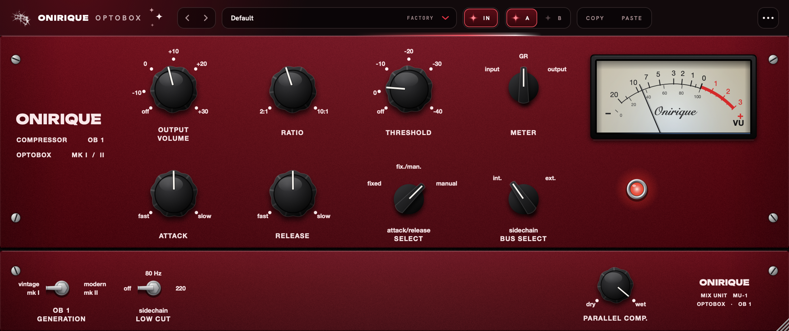

# Onirique OptoBox

Un compresseur optique à lampe dans l'esprit du grand classique danois des
années 80, avec son unité de mixage en dessous : la façade est celle de la
machine, peinte dans le rouge de la gamme Onirique, et le VU-mètre est éclairé
par une LED légèrement bleue. Un inverseur passe de la génération d'origine
(**vintage mk I**) à la génération actuelle (**modern mk II**).

VST3 (Windows, macOS) et Audio Unit (macOS). Entrée mono ou stéréo, sortie
stéréo, entrée sidechain stéréo. Aucune latence. « OptoBox » est un nom
provisoire.



---

## La façade

| Réglage | Ce qu'il fait |
|---|---|
| OUTPUT VOLUME | le gain après la compression, de off à +30 dB, rendu par l'étage à lampe |
| RATIO | 2:1 à 10:1 |
| THRESHOLD | le niveau où la compression atteint 1 dB, de off (+20) à -40 dB sous 0 VU |
| METER | ce que montre le VU : input, GR (la réduction de gain : l'aiguille descend depuis 0), output |
| ATTACK | 0,5 à 300 ms |
| RELEASE | 0,05 à 10 s |
| ATTACK/RELEASE SELECT | fixed (1 ms / 50 ms, la cellule fait le reste), fix./man., manual |
| SIDECHAIN BUS SELECT | int. : le compresseur écoute ce qu'il traite ; ext. : l'entrée sidechain du DAW |
| GENERATION | vintage mk I ⟷ modern mk II |
| SIDECHAIN LOW CUT | off, 80 Hz, 220 Hz, sur le détecteur seulement |
| PARALLEL COMP. | du son d'origine (dry) au son compressé (wet) |
| le voyant rouge | allumé, le plugin est en circuit ; un clic le met en bypass |

Au-dessus de la façade, la barre de la gamme (la même que Weight et Glue) :
les presets (flèches, navigateur avec recherche, tags et favoris, enregistrer,
renommer, supprimer), **IN** (comme le voyant, met le plugin hors circuit), la
comparaison **A / B**, **COPY / PASTE** des réglages entre deux instances, la
pastille de licence, et le menu ⋯ (copier A dans B, importer des presets, taille
de la fenêtre de 75 à 200 %). Les 15 presets d'usine (voix, batterie, basse,
instruments, mix, mastering) partent des réglages conseillés par le manuel de la
machine, avec un seuil placé pour une source à 0 VU (-18 dBFS RMS) et un gain de
sortie qui rend ce que la compression prend.

0 VU = -18 dBFS, comme le calibrage de la machine : le seuil se lit à partir de
là. Les mots imprimés autour d'un bouton ou d'un sélecteur se cliquent (« fixed »,
« 80 Hz », « +10 »…) ; les boutons se tournent en glissant, `Maj` pour régler
finement, double clic pour revenir à la valeur de départ.

## Le son, en détail

- **Le détecteur** écoute l'entrée (ou la sidechain), passe par le low cut, et
  garde une crête quelques millisecondes. Comme sur le circuit, ce niveau redressé
  charge les condensateurs d'attaque et de release ; le seuil et le ratio
  s'appliquent ensuite. La courbe a un genou très doux, placé pour qu'un niveau
  tenu au seuil soit baissé d'1 dB exactement.
- **Les temps** : en *manual*, les boutons ; en *fixed*, 1 ms et 50 ms ; en
  *fix./man.*, deux réseaux à la fois : un pic plus court que l'attaque est pris
  par le réseau rapide et relâché vite, un passage plus long tenu comme en manual.
- **La cellule optique** suit la lumière avec un léger retard et revient en deux
  temps : la plus grande part vite, le reste lentement. Plus elle a été éclairée
  fort et longtemps, plus le retour lent pèse : elle a de la mémoire, et c'est elle
  qui rend le mode fixed dépendant du programme.
- **La lampe et les transformateurs** : harmonique 2 de la lampe, harmonique 3
  quand on la pousse, saturation des graves dans le fer quand ils sont forts,
  légère bosse dans le bas et haut adouci.
- Tout ce qui distord tourne à 2× la fréquence d'échantillonnage sous 70 kHz ; le
  son dry du parallel prend les mêmes filtres pour rester en phase.

### MK I et MK II

| | vintage mk I | modern mk II |
|---|---|---|
| genou | 14 dB | 9 dB |
| retard de la cellule | 2 ms | 0,4 ms |
| retour rapide / lent | 70 ms / 3,5 s | 40 ms / 1,5 s |
| part du retour lent, cellule usée | 40 % | 25 % |
| lampe à 0 VU (H2) | -59 dB | -69 dB |
| réponse 20 Hz / 60 Hz / 20 kHz | -0,9 / +0,4 / -0,9 dB | -0,1 / +0,1 / -0,2 dB |

Les chiffres que la machine publie (plages d'attaque et de release, mode fixed,
seuil à 1 dB de compression, ratio, calibrage du VU) sont respectés et vérifiés
par les tests. Ce que font la cellule, la lampe et les transformateurs autour
d'eux est modélisé d'après le fonctionnement des composants, pas mesuré sur une
machine : l'écart entre les deux générations est un choix d'écoute à confirmer
à l'oreille, idéalement face à une vraie.

---

## Construire

JUCE 9.0.3 est cherché à côté de ce fichier, puis dans `../PitchBox/JUCE`.

```
cmake -S . -B build -DCMAKE_BUILD_TYPE=Release
cmake --build build -j 10
ctest --test-dir build
```

Sur macOS le build installe le VST3 et l'AU pour l'utilisateur. Outils de
développement :

```
cmake --build build --target optobox_snapshot
build/optobox_snapshot_artefacts/Release/optobox_snapshot snapshot.png
build/optobox_snapshot_artefacts/Release/optobox_snapshot --selftest
```

La licence est le module commun (`License/`, identifiant `onirique-optobox`),
copié de `plugin-license/` dans le dépôt ONIRIQUE CENTRAL.
